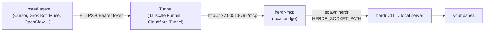

# herdr-mcp

**An MCP server that lets cloud and hosted agents drive Herdr running on your own machine.** Cursor cloud agents, Grok Bot, Muse, OpenClaw, or any remote MCP client can list, read and message the terminal panes on your laptop or home server.



It's a **thin pass-through**, not a 90-tool schema. Two tools:

- `herdr_skill` returns Herdr's own `herdr --skill` guide plus a short note for remote clients. The agent reads it once and knows the CLI.
- `herdr` runs a Herdr CLI command: `{"args":["pane","list"]}` or `{"command":"pane list"}`. Friendly verbs:

```json
{"args":["list"]}
{"args":["read","w1:p1","--lines","80"]}
{"args":["send","reviewer","Please review the current diff"]}
{"args":["wait","reviewer","--timeout","20000"]}
```

No shell is involved: arguments go straight to `herdr` via `spawn`. `command` strings support quotes and backslashes only, with no `$VAR`, `$(...)`, globs, `~`, `;` or `|`. Prefer `args` for literal Windows paths so backslashes are not parsed as escapes.

> ⚠️ **Holding the token = shell access to your machine as your user.** Read [Risks](#risks-read-this-first) before exposing it.

> Setting this up with an agent? Point it at [AGENTS.md](AGENTS.md). It's an ordered, verifiable runbook with explicit stop-and-ask points.

## Requirements

| You need | Notes |
|---|---|
| A machine that stays on | Laptop sleep = agents lose access. A home server or always-on desktop is best. |
| Linux, macOS or Windows | The bridge is plain Node. Use systemd on Linux, launchd on macOS, or WSL2 with systemd on Windows for the background setup below. Native Windows can also run it in the foreground. |
| Herdr **0.9+**, server running | `herdr --version`. It must come first on the service's PATH. |
| Node **22+** | Use Node for the service recipes below. |
| A public HTTPS tunnel | **Either** a free Tailscale account with MagicDNS, HTTPS certificates and Funnel enabled in the admin console, **or** a Cloudflare account with a domain on Cloudflare for Tunnel. |

**What only you (the human) can do:** create/log in to the Tailscale or Cloudflare account; enable HTTPS + Funnel in the Tailscale admin console (or allow it in the ACL policy); run `sudo` commands if the agent has no sudo; paste the token into Grok Bot / Cursor / other client settings; decide whether the risk is acceptable.

**What an agent can do:** everything else: clone, install, create the token, write the service, add the Funnel path, verify each step. See [AGENTS.md](AGENTS.md).

Herdr itself runs on **Linux, macOS and native Windows**. Its [v0.9.4 release](https://github.com/herdrdev/herdr/releases/tag/v0.9.4) ships Linux and macOS binaries for x86_64 and ARM64, plus a Windows x86_64 archive. WSL2 is a deployment choice, not a Herdr requirement. Keep Herdr and the bridge in the same OS environment: a bridge inside WSL controls the Herdr server inside that distribution, not a native Windows session.

## Install

Use Bash on Linux, macOS or inside WSL2. On Windows, follow [the WSL2 preparation](#windows-wsl2-with-systemd) first if you want that background setup. Replace `OWNER` with the repository owner you were given.

```sh
git clone https://github.com/OWNER/herdr-mcp ~/herdr-mcp && cd ~/herdr-mcp
npm ci --omit=dev
npm run token            # creates a token if missing; prints its path, never its contents
npm run doctor           # checks Herdr version, server connectivity and token
npm start                # http://127.0.0.1:8792/mcp
```

Every setting is an environment variable. See [.env.example](.env.example): `PORT` (8792), `HERDR_MCP_HOST` (127.0.0.1), `HERDR_MCP_BINARY` (`herdr`), `HERDR_MCP_SOCKET`, `HERDR_MCP_TOKEN_FILE`, `HERDR_MCP_ORIGINS`. The server does not load `.env` files itself.

| Default | Linux, macOS, WSL2 | Native Windows |
|---|---|---|
| Config base | `$XDG_CONFIG_HOME`, otherwise `~/.config` | `$XDG_CONFIG_HOME`, otherwise `%APPDATA%` or `%USERPROFILE%\AppData\Roaming`. Falls back to `$HOME/.config` if neither Windows profile variable exists. |
| Token | `<config base>/herdr-mcp/token` | `<config base>\herdr-mcp\token` |
| Herdr socket identifier | `<config base>/herdr/herdr.sock` | `<config base>\herdr\herdr.sock`, used by Herdr as a named-pipe identifier, not a Unix socket |

`HERDR_MCP_SOCKET` overrides `HERDR_SOCKET_PATH`, which overrides the default. Use an absolute path. Native Windows passes this identifier to Herdr, which handles the named-pipe transport. `doctor` checks connectivity through the CLI on every OS.

The token is 64 hex characters. On Linux, macOS and WSL it must belong to the service user and have no group or other permissions (`chmod 600`). On native Windows, protect the file with NTFS ACLs so other users cannot read it. The bridge checks its contents but does not validate Windows ACLs. Keep it in your private user profile.

To paste the token into a client, read the file at the path printed by `npm run token`, using `cat` in Bash or `Get-Content` in PowerShell. Never paste it into chat. To rotate it, remove that file, run `npm run token`, restart the bridge and update the clients.

### Native Windows foreground setup

Install native Node 22+ and [Herdr for Windows](https://herdr.dev/docs/windows-beta/). Open Herdr so its server is running, then in PowerShell:

```powershell
git clone https://github.com/OWNER/herdr-mcp "$HOME/herdr-mcp"
Set-Location "$HOME/herdr-mcp"
npm ci --omit=dev
npm run token
npm run doctor
npm start
```

Use a native `herdr.exe`, not a `.cmd` or `.bat` wrapper. Stop with Ctrl+C. The background recipes below include WSL2 for Windows. No native Windows service wrapper is shipped.

## Keep the bridge running

These recipes supervise the bridge, not Herdr or your tunnel. Those must also be running. Stop a foreground `npm start` before starting a service on the same port.

### Linux: systemd user service

```sh
mkdir -p ~/.config/herdr-mcp ~/.config/systemd/user
[ -f ~/.config/herdr-mcp/service.env ] || cp .env.example ~/.config/herdr-mcp/service.env
[ -f ~/.config/systemd/user/herdr-mcp.service ] || cp systemd/herdr-mcp.service ~/.config/systemd/user/
```

Edit `service.env`: put absolute directories for Herdr 0.9+ and Node first in `PATH`. Set a custom token or socket path if needed. Edit `WorkingDirectory` in the copied unit if the repository is not `~/herdr-mcp`. Do not overwrite an existing service without reviewing it.

```sh
systemctl --user daemon-reload
systemctl --user enable --now herdr-mcp.service
loginctl enable-linger "$USER"                        # keep running after logout
systemctl --user is-active herdr-mcp
journalctl --user -u herdr-mcp -n 20
```

systemd does **not** read your shell rc, so mise/nvm/asdf shims aren't on PATH. Put absolute directories in `service.env` (systemd doesn't expand `%h`, `~` or `$HOME` there), or an absolute node path in `ExecStart`.

### macOS: launchd user agent

```sh
mkdir -p ~/Library/LaunchAgents ~/Library/Logs
[ -f ~/Library/LaunchAgents/dev.herdr-mcp.plist ] || cp launchd/dev.herdr-mcp.plist ~/Library/LaunchAgents/
command -v node
command -v herdr
```

Edit the copied [plist](launchd/dev.herdr-mcp.plist). Replace every `/Users/YOU`, set the actual Node executable in `ProgramArguments`, and set the repository, token, socket and log paths. Adjust `PATH` to include Herdr's directory. `/opt/homebrew/bin/node` is only an example. For mise, nvm or asdf, resolve the real executable rather than a shim. The macOS default socket is `~/.config/herdr/herdr.sock`, unless you changed `XDG_CONFIG_HOME` or selected another session.

launchd does not expand `~` or `$HOME`, read your shell rc, or load `service.env`. Put settings in `EnvironmentVariables` with literal absolute paths. XML-escape `&` as `&amp;` in paths.

```sh
plutil -lint ~/Library/LaunchAgents/dev.herdr-mcp.plist
launchctl bootstrap "gui/$(id -u)" ~/Library/LaunchAgents/dev.herdr-mcp.plist
launchctl print "gui/$(id -u)/dev.herdr-mcp"   # look for state = running
tail -n 20 ~/Library/Logs/herdr-mcp.log
```

For an already loaded agent, use `launchctl bootout "gui/$(id -u)/dev.herdr-mcp"` before bootstrapping an edited plist. To restart without changing settings: `launchctl kickstart -k "gui/$(id -u)/dev.herdr-mcp"`.

This LaunchAgent starts at login and restarts the bridge if it exits. It does not run while logged out or keep a sleeping Mac awake. A headless, pre-login service needs a separately configured LaunchDaemon.

### Windows: WSL2 with systemd

Install a WSL2 distribution such as Ubuntu. In PowerShell, `wsl --list --verbose` must show version `2`. Install Linux Node and Herdr **inside that distribution**, with the repository in its Linux home directory. Use its Bash terminal for the install and Linux systemd steps above.

Recent Ubuntu WSL installations enable systemd by default. Check inside WSL:

```sh
ps -p 1 -o comm=                       # systemd
systemctl --user is-system-running    # running or degraded
```

If needed, merge this setting into `/etc/wsl.conf` without replacing other settings:

```ini
[boot]
systemd=true
```

Then run `wsl --shutdown` in PowerShell and reopen the distribution. **This stops every running WSL distribution**, so save work and ask before doing it. See [Microsoft's systemd setup](https://learn.microsoft.com/en-us/windows/wsl/systemd).

Enable the user service and lingering using the Linux recipe. WSL's lifetime still matters: systemd services alone do not keep a distribution alive, and lingering does not start WSL after a Windows reboot. For unattended use while Windows is awake, create a Task Scheduler task under your Windows account at logon that runs `wsl.exe` with arguments `-d Ubuntu --exec sleep infinity`. Replace `Ubuntu` with your distribution name and disable the task's execution time limit. Start the task and verify the bridge from a second WSL terminal. Windows shutdown, sleep and `wsl --shutdown` still interrupt access.

Run the tunnel inside the same distribution so its loopback target reaches the bridge. Do not mix a Windows-host tunnel with WSL loopback without configuring and verifying that networking separately.

## Expose it

The server only listens on loopback. Put HTTPS in front of it.

### Tailscale Funnel (port 443, under a path)

```sh
tailscale funnel --bg --set-path /herdr-mcp http://127.0.0.1:8792/mcp
tailscale funnel status
```

Your URL is `https://<machine>.<tailnet>.ts.net/herdr-mcp`. This adds a path handler next to anything already on 443. **Never run `tailscale serve reset` or `tailscale funnel reset`**, because they wipe every other service on the node. To remove just this one: `tailscale funnel --set-path /herdr-mcp off`.

For tailnet-only access, use `tailscale serve` with the same arguments.

Use 443. Funnel also allows 8443 and 10000, but hosted MCP clients (Grok Bot's backend, in our testing) couldn't reach `:10000`. Plain 443 with a path works everywhere.

### Cloudflare Tunnel (alternative)

```sh
cloudflared tunnel create herdr-mcp
cloudflared tunnel route dns herdr-mcp herdr-mcp.example.com
cloudflared tunnel run --url http://127.0.0.1:8792 herdr-mcp
```

URL: `https://herdr-mcp.example.com/mcp`. Cloudflare Workers alone won't work, because they can't spawn the local Herdr CLI or reach its server. The tunnel has to run on the Herdr machine.

## Client setup

Every client sends `Authorization: Bearer <token>`. Never commit the token.

**Grok Bot:** Settings → Connectors → add a custom/remote MCP (HTTP):
- URL: `https://<machine>.<tailnet>.ts.net/herdr-mcp`
- Header: `Authorization` = `Bearer <paste token>`

Then ask it: "use herdr_skill, then list my panes".

**Cursor cloud agents** (cursor.com/agents → MCP → add custom server). Paste the real token in the UI, or keep it as a secret named `HERDR_MCP_TOKEN`:

```json
{
  "mcpServers": {
    "herdr": {
      "url": "https://<machine>.<tailnet>.ts.net/herdr-mcp",
      "headers": { "Authorization": "Bearer ${env:HERDR_MCP_TOKEN}" }
    }
  }
}
```

**Cursor desktop:** `~/.cursor/mcp.json` or `.cursor/mcp.json` gets the same JSON. Export `HERDR_MCP_TOKEN` in your environment, and never commit a literal token.

## Risks (read this first)

Plainly: **this is remote control of your terminals.**

- **Token = shell.** Anyone holding it can type into your panes (`pane run`, `send`), i.e. run arbitrary commands as your user, and read anything on screen, secrets included. The CLI allow-list is an accident guard, **not a sandbox**.
- **Prompt injection.** A hosted agent that reads hostile content (a web page, an issue, an email, a file in a repo) can be steered into sending commands to your panes. The bridge can't tell a legitimate instruction from an injected one.
- **It's on the public internet.** Funnel and Tunnel make the URL reachable by anyone. Only the token stands between them and your panes.
- **Token leakage.** Chat logs, screenshots, committed `mcp.json` files, shell history, client config sync.
- **Third parties hold the token.** Once pasted into Grok Bot, Cursor, etc., that provider's systems store it and send requests on your behalf. You're trusting their security too.

**What actually protects you** (verified in `src/`):
- Bearer auth on every request, constant-time compare (`timingSafeEqual`). The token must be exactly 64 hex chars. POSIX systems also enforce ownership and private mode bits. On native Windows, you must restrict access through NTFS ACLs yourself.
- Binds to `127.0.0.1` by default; only reachable through your tunnel.
- Session pin: the socket is fixed via `HERDR_SOCKET_PATH`. `--session`, `--machine`, `--remote`, `--remote-keybindings` are rejected. Only `pane`, `agent`, `workspace`, `tab`, `notification`, `status`, `api` subcommands run, so no server maintenance or bare TUI; `api --output` file writes are blocked. Input commands need an explicit target, so no `--current`.
- No shell: `spawn` with a minimal environment (`HOME`, `PATH`, `LANG`, socket, plus Windows loader and profile variables where needed). `command` strings reject unquoted shell operators.
- Limits: 25 s per call, 128 KiB output, 128 KiB request body, 4 concurrent subprocesses, 16 in-flight requests, 64 connections, header/request timeouts.
- Browser `Origin`s rejected unless listed in `HERDR_MCP_ORIGINS`.
- Stateless: no transcript stored. systemd unit runs with `NoNewPrivileges` and `UMask=0077`.

None of these stop a token holder (or a hijacked agent) from running commands in a pane.

**Mitigations we recommend:**
- Run a **dedicated Herdr session** for agents and point `HERDR_MCP_SOCKET` at it, so your personal panes aren't reachable.
- Keep the generated 256-bit token; **rotate** it (`rm` the file, `npm run token`, restart, re-paste) whenever it might have leaked.
- **Turn Funnel off** when you don't need it: `tailscale funnel --set-path /herdr-mcp off`. Or use `tailscale serve` (tailnet-only) if your clients are on your tailnet.
- **Never commit the token.** Use `${env:HERDR_MCP_TOKEN}` / client secrets.
- Paranoid: run Herdr and herdr-mcp as a separate, unprivileged OS user with no administrator access and no access to your files or SSH keys.

## Troubleshooting (every step that bit us)

| Symptom | Fix |
|---|---|
| `doctor` shows Herdr `0.8.x` over SSH or systemd, but `0.9` in your terminal | A stale `/usr/bin/herdr` shadows `~/.local/bin/herdr` in non-interactive shells. Remove or upgrade it, or put `~/.local/bin` first in `service.env` PATH, or set `HERDR_MCP_BINARY=/home/you/.local/bin/herdr`. |
| Service fails with `node: not found` | Service managers do not load your interactive PATH. Set the real Node path in systemd's `ExecStart` or launchd's `ProgramArguments`, and Herdr's directory in the service environment. |
| `Token file ... must be ... mode 0600` | Run `chmod 600 ~/.config/herdr-mcp/token`. The owner must be the service user. |
| `doctor` cannot reach the socket | Open Herdr or correct `HERDR_MCP_SOCKET`. Native Windows uses a named pipe, so looking for a socket file on disk is not a connectivity check. Keep both processes in the same OS environment and user context. |
| Hosted client times out on `https://...ts.net:10000` | Move to 443 with `--set-path /herdr-mcp` (see above). |
| Another box on your tailnet resolves `*.ts.net` to `198.18.0.1` and can't connect | Its MagicDNS or a proxy is returning a fake address. Pin the real tailnet IP in `/etc/hosts`: `100.x.y.z <machine>.<tailnet>.ts.net <machine>` (get it from `tailscale ip -4` on the server). |
| Funnel says it isn't enabled | Turn on HTTPS certificates and Funnel in the Tailscale admin console (DNS → HTTPS; Access controls → `funnel` nodeAttr). This needs a human. |
| `401` | The header must be exactly `Authorization: Bearer <64 hex>`, with no quotes or newline. |
| `404` through Funnel | The proxy target must end in `/mcp`: `http://127.0.0.1:8792/mcp`. |
| `403 Origin not allowed` | You're calling from a browser. Add its origin to `HERDR_MCP_ORIGINS`. |

Never `tailscale serve reset` / `tailscale funnel reset` on a shared node.

## Develop

```sh
npm ci && npm run check
```

## License

MIT © Igor Warzocha
