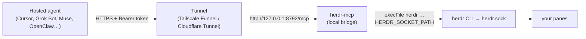

# herdr-mcp

**An MCP server that lets cloud and hosted agents drive Herdr running on your own machine.** Cursor cloud agents, Grok Bot, Muse, OpenClaw, or any remote MCP client can list, read and message the terminal panes on your laptop or home server.



It's a **thin pass-through**, not a 90-tool schema. Two tools:

- `herdr_skill` returns Herdr's own `herdr --skill` guide plus a short note for remote clients. The agent reads it once and knows the CLI.
- `herdr` runs a Herdr CLI command: `{"args":["pane","list"]}` or `{"command":"pane list"}`. Friendly verbs:

```json
{"args":["list"]}
{"args":["read","w1:p1","--lines","80"]}
{"args":["send","reviewer","Please review the current diff"]}
{"args":["wait","reviewer","--timeout","20000"]}
```

No shell is involved: arguments go straight to `herdr` via `execFile`. `command` strings support quotes and backslashes only, with no `$VAR`, `$(...)`, globs, `~`, `;` or `|`.

> ⚠️ **Holding the token = shell access to your machine as your user.** Read [Risks](#risks-read-this-first) before exposing it.

> Setting this up with an agent? Point it at [AGENTS.md](AGENTS.md). It's an ordered, verifiable runbook with explicit stop-and-ask points.

## Requirements

| You need | Notes |
|---|---|
| A machine that stays on | Laptop sleep = agents lose access. A home server or always-on desktop is best. |
| Linux (tested) or macOS (**untested**) | The code is plain Node and portable. The shipped service file is systemd-only; macOS/WSL/containers use launchd or `nohup` (below). |
| Herdr **0.9+**, server running | `herdr --version`. It must come first on the service's PATH. |
| Node **22+** | `engines` in package.json. (The code needs ≥ 20.3 for `AbortSignal.any`, but only 22 is tested.) Bun also works: `bun bin/herdr-mcp.mjs`. |
| A public HTTPS tunnel | **Either** a free Tailscale account with MagicDNS, HTTPS certificates and Funnel enabled in the admin console, **or** a Cloudflare account with a domain on Cloudflare for Tunnel. |

**What only you (the human) can do:** create/log in to the Tailscale or Cloudflare account; enable HTTPS + Funnel in the Tailscale admin console (or allow it in the ACL policy); run `sudo` commands if the agent has no sudo; paste the token into Grok Bot / Cursor / other client settings; decide whether the risk is acceptable.

**What an agent can do:** everything else: clone, install, create the token, write the service, add the Funnel path, verify each step. See [AGENTS.md](AGENTS.md).

## Install

```sh
git clone https://github.com/OWNER/herdr-mcp ~/herdr-mcp && cd ~/herdr-mcp
npm ci --omit=dev        # or: bun install
npm run token            # creates ~/.config/herdr-mcp/token (64 hex chars, mode 0600)
npm run doctor           # checks herdr version/PATH, socket, token
npm start                # http://127.0.0.1:8792/mcp
```

Every setting is an env var with a sane default. See [.env.example](.env.example): `PORT` (8792), `HERDR_MCP_HOST` (127.0.0.1), `HERDR_MCP_BINARY` (`herdr`), `HERDR_MCP_SOCKET` (`~/.config/herdr/herdr.sock`), `HERDR_MCP_TOKEN_FILE` (`~/.config/herdr-mcp/token`), `HERDR_MCP_ORIGINS`.

Print the token when you need to paste it into a client: `cat ~/.config/herdr-mcp/token`. Rotate it with `rm` plus `npm run token`, then restart the service.

## Run as a systemd user service

```sh
mkdir -p ~/.config/herdr-mcp ~/.config/systemd/user
cp .env.example ~/.config/herdr-mcp/service.env      # edit PATH (absolute dirs, Herdr 0.9+ and node first)
cp systemd/herdr-mcp.service ~/.config/systemd/user/ # edit WorkingDirectory if not ~/herdr-mcp
systemctl --user daemon-reload
systemctl --user enable --now herdr-mcp.service
loginctl enable-linger "$USER"                        # keep running after logout
journalctl --user -u herdr-mcp -n 20
```

systemd does **not** read your shell rc, so mise/nvm/asdf shims aren't on PATH. Put absolute directories in `service.env` (systemd doesn't expand `%h`, `~` or `$HOME` there), or an absolute node path in `ExecStart`.

### No systemd (macOS, WSL without systemd, containers)

Plain background process (doesn't survive reboot):
```sh
cd ~/herdr-mcp && set -a && . ~/.config/herdr-mcp/service.env && set +a
nohup node bin/herdr-mcp.mjs >> ~/.config/herdr-mcp/log 2>&1 &
```

macOS launchd (untested): create `~/Library/LaunchAgents/dev.herdr-mcp.plist` with `ProgramArguments` = `[/absolute/path/to/node, bin/herdr-mcp.mjs]`, `WorkingDirectory` = the repo, `EnvironmentVariables` holding `PATH` (absolute, Herdr 0.9+ first) and `PORT`, `RunAtLoad` and `KeepAlive` true. Then `launchctl load ~/Library/LaunchAgents/dev.herdr-mcp.plist`. Check where Herdr puts its socket on macOS and set `HERDR_MCP_SOCKET` if it isn't `~/.config/herdr/herdr.sock`.

## Expose it

The server only listens on loopback. Put HTTPS in front of it.

### Tailscale Funnel (port 443, under a path)

```sh
tailscale funnel --bg --set-path /herdr-mcp http://127.0.0.1:8792/mcp
tailscale funnel status
```

Your URL is `https://<machine>.<tailnet>.ts.net/herdr-mcp`. This adds a path handler next to anything already on 443. **Never run `tailscale serve reset` or `tailscale funnel reset`**, because they wipe every other service on the node. To remove just this one: `tailscale funnel --set-path /herdr-mcp off`.

For tailnet-only access, use `tailscale serve` with the same arguments.

Use 443. Funnel also allows 8443 and 10000, but hosted MCP clients (Grok Bot's backend, in our testing) couldn't reach `:10000`. Plain 443 with a path works everywhere.

### Cloudflare Tunnel (alternative)

```sh
cloudflared tunnel create herdr-mcp
cloudflared tunnel route dns herdr-mcp herdr-mcp.example.com
cloudflared tunnel run --url http://127.0.0.1:8792 herdr-mcp
```

URL: `https://herdr-mcp.example.com/mcp`. Cloudflare Workers alone won't work, because they can't spawn processes or reach a Unix socket. The tunnel has to run on the Herdr machine.

## Client setup

Every client sends `Authorization: Bearer <token>`. Never commit the token.

**Grok Bot:** Settings → Connectors → add a custom/remote MCP (HTTP):
- URL: `https://<machine>.<tailnet>.ts.net/herdr-mcp`
- Header: `Authorization` = `Bearer <paste token>`

Then ask it: "use herdr_skill, then list my panes".

**Cursor cloud agents** (cursor.com/agents → MCP → add custom server). Paste the real token in the UI, or keep it as a secret named `HERDR_MCP_TOKEN`:

```json
{
  "mcpServers": {
    "herdr": {
      "url": "https://<machine>.<tailnet>.ts.net/herdr-mcp",
      "headers": { "Authorization": "Bearer ${env:HERDR_MCP_TOKEN}" }
    }
  }
}
```

**Cursor desktop:** `~/.cursor/mcp.json` or `.cursor/mcp.json` gets the same JSON. Export `HERDR_MCP_TOKEN` in your environment, and never commit a literal token.

## Risks (read this first)

Plainly: **this is remote control of your terminals.**

- **Token = shell.** Anyone holding it can type into your panes (`pane run`, `send`), i.e. run arbitrary commands as your user, and read anything on screen, secrets included. The CLI allow-list is an accident guard, **not a sandbox**.
- **Prompt injection.** A hosted agent that reads hostile content (a web page, an issue, an email, a file in a repo) can be steered into sending commands to your panes. The bridge can't tell a legitimate instruction from an injected one.
- **It's on the public internet.** Funnel and Tunnel make the URL reachable by anyone. Only the token stands between them and your panes.
- **Token leakage.** Chat logs, screenshots, committed `mcp.json` files, shell history, client config sync.
- **Third parties hold the token.** Once pasted into Grok Bot, Cursor, etc., that provider's systems store it and send requests on your behalf. You're trusting their security too.

**What actually protects you** (verified in `src/`):
- Bearer auth on every request, constant-time compare (`timingSafeEqual`). The token must be exactly 64 hex chars in a file owned by the service user with no group/other permissions, or the server refuses to start.
- Binds to `127.0.0.1` by default; only reachable through your tunnel.
- Session pin: the socket is fixed via `HERDR_SOCKET_PATH`. `--session`, `--machine`, `--remote`, `--remote-keybindings` are rejected. Only `pane`, `agent`, `workspace`, `tab`, `notification`, `status`, `api` subcommands run, so no server maintenance or bare TUI; `api --output` file writes are blocked. Input commands need an explicit target, so no `--current`.
- No shell: `execFile` with a minimal env (`HOME`, `PATH`, `LANG`, socket). `command` strings reject `; | & < > \``.
- Limits: 25 s per call, 128 KiB output, 128 KiB request body, 4 concurrent subprocesses, 16 in-flight requests, 64 connections, header/request timeouts.
- Browser `Origin`s rejected unless listed in `HERDR_MCP_ORIGINS`.
- Stateless: no transcript stored. systemd unit runs with `NoNewPrivileges` and `UMask=0077`.

None of these stop a token holder (or a hijacked agent) from running commands in a pane.

**Mitigations we recommend:**
- Run a **dedicated Herdr session** for agents and point `HERDR_MCP_SOCKET` at it, so your personal panes aren't reachable.
- Keep the generated 256-bit token; **rotate** it (`rm` the file, `npm run token`, restart, re-paste) whenever it might have leaked.
- **Turn Funnel off** when you don't need it: `tailscale funnel --set-path /herdr-mcp off`. Or use `tailscale serve` (tailnet-only) if your clients are on your tailnet.
- **Never commit the token.** Use `${env:HERDR_MCP_TOKEN}` / client secrets.
- Paranoid: run Herdr and herdr-mcp as a separate, unprivileged Linux user with no sudo and no access to your files or SSH keys.

## Troubleshooting (every step that bit us)

| Symptom | Fix |
|---|---|
| `doctor` shows Herdr `0.8.x` over SSH or systemd, but `0.9` in your terminal | A stale `/usr/bin/herdr` shadows `~/.local/bin/herdr` in non-interactive shells. Remove or upgrade it, or put `~/.local/bin` first in `service.env` PATH, or set `HERDR_MCP_BINARY=/home/you/.local/bin/herdr`. |
| Service fails with `node: not found` | systemd has no mise/nvm PATH. Add the node bin dir to `service.env` PATH, or use an absolute `ExecStart`. |
| `Token file ... must be ... mode 0600` | Run `chmod 600 ~/.config/herdr-mcp/token`. The owner must be the service user. |
| `missing ...herdr.sock` | Start Herdr (`herdr server` / open herdr) or set `HERDR_MCP_SOCKET`. |
| Hosted client times out on `https://...ts.net:10000` | Move to 443 with `--set-path /herdr-mcp` (see above). |
| Another box on your tailnet resolves `*.ts.net` to `198.18.0.1` and can't connect | Its MagicDNS or a proxy is returning a fake address. Pin the real tailnet IP in `/etc/hosts`: `100.x.y.z <machine>.<tailnet>.ts.net <machine>` (get it from `tailscale ip -4` on the server). |
| Funnel says it isn't enabled | Turn on HTTPS certificates and Funnel in the Tailscale admin console (DNS → HTTPS; Access controls → `funnel` nodeAttr). This needs a human. |
| `401` | The header must be exactly `Authorization: Bearer <64 hex>`, with no quotes or newline. |
| `404` through Funnel | The proxy target must end in `/mcp`: `http://127.0.0.1:8792/mcp`. |
| `403 Origin not allowed` | You're calling from a browser. Add its origin to `HERDR_MCP_ORIGINS`. |

Never `tailscale serve reset` / `tailscale funnel reset` on a shared node.

## Develop

```sh
npm ci && npm run check
```

## License

MIT © Igor Warzocha
